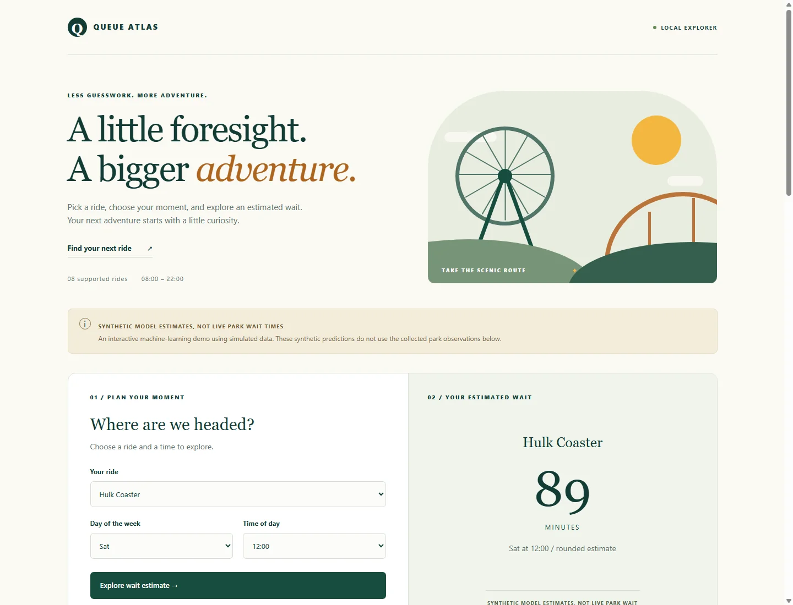
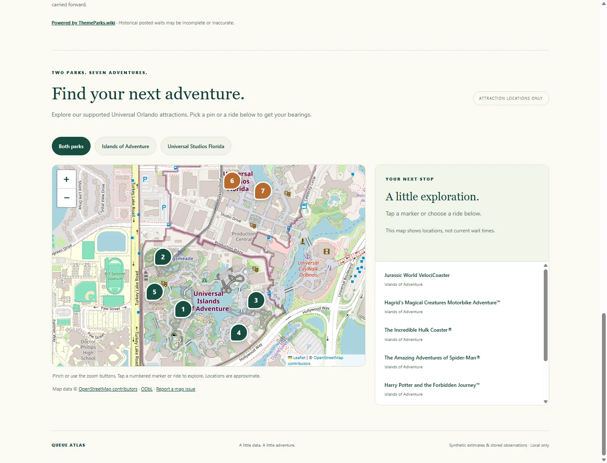
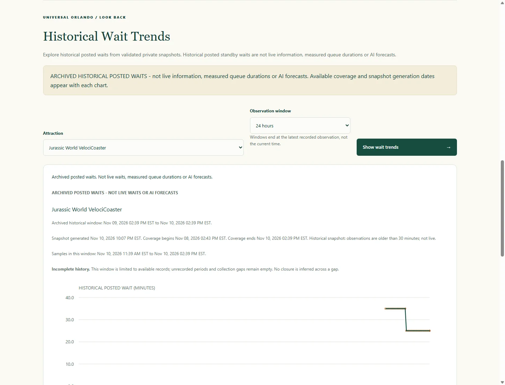
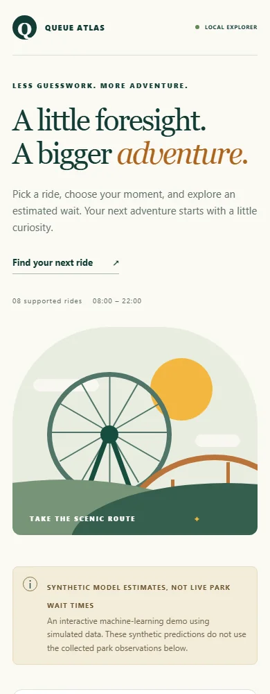
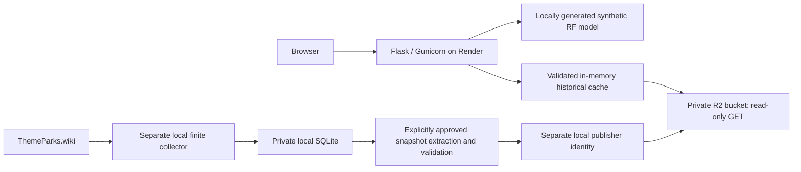

# Queue Atlas

### Universal Orlando Wait-Time Explorer

[Live website](https://queue-atlas.onrender.com) | [GitHub repository](https://github.com/LeonTolentino30/theme-park-wait-times)

Queue Atlas is a full-stack Python project for exploring Universal Orlando attractions, synthetic machine-learning estimates and genuine historical posted waits. It combines a responsive Flask website, an interactive park map and server-rendered historical charts backed by private Cloudflare R2 storage.

**Public launch: November 11, 2026.** The public historical feature was checked against the running website on that date. Predictions remain trained exclusively on synthetic data; collected observations power historical charts, not the Random Forest.

> **Synthetic predictions are not live park wait times or validated real-world forecasts. Historical posted waits are archived observations, not measured queue durations.** Queue Atlas is an independent portfolio project and is not affiliated with Universal Orlando or ThemeParks.wiki.

## Features

- **Synthetic wait estimates:** choose a dataset ride name, weekday and integer hour from 08:00-22:00. The app validates inputs, rounds the result to whole minutes and clearly labels it as synthetic.
- **Interactive attraction map:** Leaflet markers, park filters, attraction details and a list fallback for seven active attractions. OpenStreetMap tiles load only after clicking **Load Interactive Map**. Locations do not imply current wait times.
- **Current Posted Waits:** the local application reads the latest successfully stored collector observations, groups rides by park and distinguishes operating, closed, down, missing and stale states. This is a stored-data view, not a direct live feed. The public production configuration disables local SQLite reads and shows unavailable current observations; archived history is not substituted for current waits.
- **Historical Wait Trends:** select any of the seven active attractions and a 6-hour, 24-hour or 7-day window. Production retrieves validated private snapshots on the server and returns HTML/SVG charts. Windows end at the latest recorded observation, not the present time. Coverage dates, snapshot generation time and incomplete-history warnings remain visible.
- **Private collection and storage:** a separate finite seven-day ThemeParks.wiki pilot writes local SQLite observations. Approved snapshots can be stored privately in R2; the public website never needs the collector database.

## Screenshots

Actual screenshots captured from [the running public application](https://queue-atlas.onrender.com) on November 11, 2026 using an isolated Chrome profile. These are not fixture demonstrations or generated mockups. WebP compression keeps the documentation lightweight. The mobile image is a 390px browser viewport, not proof of physical iPhone/Safari testing. Some existing interface copy still says "Local Explorer" or "Local only"; the images preserve the deployed UI unchanged.

### Desktop homepage and synthetic prediction



### Interactive Universal Orlando map



### Genuine archived Historical Wait Trends



### Mobile layout



## Supported attractions

The map, historical selector and approved real-data scope cover **seven active attractions across two parks**. Exact provider UUIDs and OpenStreetMap provenance are checked by the registry/map tests; locations are approximate attraction points, not navigation or entrance guarantees.

| Park | Attraction | Synthetic selector name |
|---|---|---|
| Islands of Adventure | Jurassic World VelociCoaster | `VelociCoaster` |
| Islands of Adventure | Hagrid's Magical Creatures Motorbike Adventure | `Hagrid's Motorbike` |
| Islands of Adventure | The Incredible Hulk Coaster | `Hulk Coaster` |
| Islands of Adventure | The Amazing Adventures of Spider-Man | `Spider-Man` |
| Islands of Adventure | Harry Potter and the Forbidden Journey | `Forbidden Journey` |
| Universal Studios Florida | Revenge of the Mummy | `Revenge of the Mummy` |
| Universal Studios Florida | TRANSFORMERS: The Ride-3D | `Transformers` |

The original synthetic dataset has **eight** ride categories. Its preserved `Rip Ride Rockit` option refers to retired Hollywood Rip Ride Rockit; it is excluded from active collection, the map and real historical charts. The homepage's eight-ride count describes that synthetic demo.

## Architecture

| Component | Implementation |
|---|---|
| Application | Python, Flask application factory in `app.py`, production `wsgi:application` |
| Frontend | Jinja templates, HTML, CSS and vanilla JavaScript; responsive forest-green, cream and orange design |
| Mapping | Locally vendored Leaflet, verified OpenStreetMap-derived GeoJSON and consent-triggered OpenStreetMap tiles |
| Synthetic ML | pandas/NumPy preprocessing, scikit-learn Random Forest pipeline and joblib runtime artifacts |
| Local collection | Standard-library ThemeParks.wiki adapter, finite foreground collector and private SQLite storage |
| Public history | Read-only R2 adapter, versioned snapshot/manifest validation, SHA-256 integrity and server-rendered HTML/SVG |
| Source and hosting | GitHub repository; Render Free web service with Gunicorn |



The extraction/publication arrows are separately approved manual operations, not a scheduled export or part of web startup. Render receives only read-only storage credentials. No collector, SQLite database, private snapshot or publisher credential belongs in the deployed Git checkout. The existing local SQLite charts remain available independently of production R2 charts.

### Main directories

```text
app.py / wsgi.py       Flask routes and production entry point
src/                   ML, provider, collector, snapshot, storage and chart code
templates/ / static/   Frontend, Leaflet assets and attraction map data
data/raw/              Included synthetic training CSV
reports/               Published synthetic evaluation results
models/                Generated runtime artifacts (Git-ignored)
private/               Local observations/snapshots/logs (Git-ignored)
tests/                 Automated tests and explicitly synthetic fixtures
docs/ / tools/         Detailed guides, screenshots and secure local helpers
```

## Historical data: initial release

The initial private version-2 snapshot contains **602 genuine observations**, 86 per supported attraction, collected during incomplete **November 8-10, 2026 UTC** coverage. It is a small archived sample, not a continuously updated seven-day history.

| Coverage metadata | Initial snapshot |
|---|---|
| First observation (UTC) | November 8, 2026, 19:43:55.693279 |
| Last observation (UTC) | November 10, 2026, 19:39:38.614260 |
| Snapshot generated (UTC) | November 11, 2026, 03:07:13.542339 |
| Operating numeric waits | 467 |
| CLOSED / DOWN observations | 112 / 23 |
| Null waits | 135, including the closed/down records above |
| Genuine operating zero waits in this snapshot | 0; zero remains supported and tested |
| Gaps longer than 7.5 minutes | 28 per-attraction gaps, including a roughly 39-hour interruption |

These are aggregate quality statistics, not a public observation export. Charts preserve closures, DOWN states, missing values and gaps as breaks/events. No interpolation, smoothing, invented observations or closure inference across gaps is used. UTC timestamps retain fractional precision; presentation uses `America/New_York` with timezone labels.

The 6h/24h/7d controls describe requested archived windows ending at recorded coverage. They show only genuine available samples. A 7-day selection does not imply seven days were collected; insufficient numeric data produces an honest message. Historical choices do not depend on Current Posted Waits being available.

The private R2 manifest points to a content-addressed immutable snapshot. The adapter checks size, checksum, schema, timestamps and attraction/park mappings before rendering. It uses a bounded, lock-protected memory cache, five-minute request-driven conditional refresh and safe failure cooldown. There is no background refresh collector. Restarting the web service reloads the private objects on demand; a new archive requires separate validated snapshot publication.

## Synthetic model and evaluation

`data/raw/wait_times.csv` contains **5,000 synthetic rows**, eight rides, seven weekdays and hours 8-22. `src/generate_dataset.py` documents the generator: manually assigned ride popularity, weekend/hour effects and random noise. There are 839 unique ride/day/hour combinations out of 840 possible. No real dates, weather, holidays, closures or crowd measurements are included.

The reviewed pipeline fixes seeds at 42, trains a 200-tree Random Forest with one worker and keeps all 16 encoded features and their order with the model. A training-mean baseline is evaluated on each split. No hyperparameter tuning was performed.

| Holdout | Model | MAE (minutes) | RMSE (minutes) | R^2 |
|---|---|---:|---:|---:|
| Random rows | Mean baseline | 16.7085 | 20.4698 | -0.0005 |
| Random rows | Random Forest | 8.0044 | 9.8673 | 0.7675 |
| Unseen feature combinations | Mean baseline | 15.2101 | 18.9815 | -0.0053 |
| Unseen feature combinations | Random Forest | 8.2708 | 10.1408 | 0.7131 |

MAE/RMSE are lower-is-better errors; R^2 is explained variance, **not percentage accuracy**. The random split has 4,000 train / 1,000 test rows and 582 shared feature combinations. The grouped split has 4,024 train / 976 test rows and no shared combinations. Grouped evaluation tests unseen combinations of known categories; it is not chronological validation or proof of real-world performance. Repeated combinations are independent synthetic draws, not longitudinal observations. Both evaluations use single fixed holdouts without confidence intervals.

The final inference model fits all 5,000 rows after evaluation. Holdout scores belong to separate evaluation models. The 602 real observations have **not** been used to retrain it. More dated observations and time-based evaluation are required before claiming a real forecasting model. See [published evaluation](reports/synthetic_rf_v1.json).

## Local development

Use Python 3.12. Local checks used 3.12.7; Render is configured for 3.12.16. From a fresh checkout in PowerShell:

```powershell
git clone https://github.com/LeonTolentino30/theme-park-wait-times.git
cd theme-park-wait-times
python -m venv venv
.\venv\Scripts\python.exe -m pip install -r requirements.txt
.\venv\Scripts\python.exe -m pip check

# Fresh checkout only: generate trusted synthetic runtime artifacts.
.\venv\Scripts\python.exe -B -m src.ml_pipeline train
.\venv\Scripts\python.exe -B -m unittest discover -s tests -v
.\venv\Scripts\python.exe -B app.py
```

Open **http://127.0.0.1:5000/** and stop Flask with Ctrl+C. Debug and the reloader are disabled. Starting Flask never starts collection. A fresh checkout supports synthetic predictions and the map without real observations or R2 credentials; local real-data views show unavailable until separately configured. On macOS/Linux, substitute `python3` and `venv/bin/python` for the Windows commands.

Training writes Git-ignored `models/synthetic_rf_v1.joblib` and `models/synthetic_rf_v1.manifest.json`. It never rewrites `reports/synthetic_rf_v1.json`. **Training refuses to overwrite either existing runtime artifact**; do not rerun it on a working installation or delete artifacts to bypass that protection. Partial outputs require manual review. Do not run legacy `src/train_model.py`, which targets the old model filename.

Joblib deserialization can execute code. Use only models generated locally from reviewed source. The loader checks its fixed v1 artifact hash against the runtime manifest; older verified installations can use the original evaluation hash fallback. An existing invalid manifest never falls back. Integrity hashes do not authenticate an attacker-controlled artifact plus manifest. The preserved old `models/wait_time_model.pkl` is never loaded by the new application.

Optional synthetic CLI:

```powershell
.\venv\Scripts\python.exe -B -m src.ml_pipeline predict --ride "Hulk Coaster" --day Sat --hour 12
```

Inputs use exact case-sensitive dataset ride names, `Mon Tue Wed Thu Fri Sat Sun`, and integer hours 8-22. Unsupported values are rejected rather than silently normalized. The Python entry point `from src.utils import predict_wait_time` does not train or load a model on import.

### HTTP interfaces

| Route | Purpose |
|---|---|
| `GET /` | Responsive frontend |
| `GET /healthz` | Model readiness; no internal details |
| `POST /api/predict` | Validated synthetic estimate |
| `GET /api/map-attractions` | Public seven-attraction geographic registry |
| `GET /history/chart` | Validated server-rendered historical HTML/SVG when enabled |
| `GET /api/current-waits`, `GET /api/history` | Local read-only SQLite views; **disabled in public production** |

Prediction requests require JSON with exactly `ride`, `day`, `hour`:

```json
{"ride":"Hulk Coaster","day":"Sat","hour":12}
```

The reference model returns 89 rounded minutes for that example, with `synthetic: true` and the synthetic disclaimer. Rounding uses nearest whole minute, halves up. Invalid input returns 400, request bodies over 4 KB return 413, and unavailable model/storage conditions return sanitized errors. Public prediction and chart guards allow 60 and 30 requests/minute/worker respectively; these are basic in-memory limits, not distributed abuse protection. Raw historical JSON, private snapshot downloads and credentials are not public APIs.

### Configuration and credentials

`app.py` uses local configuration; `wsgi.py` constructs explicitly public production configuration. Production history defaults off unless enabled with the following environment variables:

| Variable | Configuration |
|---|---|
| `QUEUE_ATLAS_HISTORY_ENABLED` | `1` for approved R2 history; `0` to disable |
| `QUEUE_ATLAS_R2_ACCOUNT_ID` | R2 account identifier |
| `QUEUE_ATLAS_R2_BUCKET` | Private history bucket name |
| `QUEUE_ATLAS_R2_READ_ACCESS_KEY_ID` | Bucket-scoped Object Read S3 key ID |
| `QUEUE_ATLAS_R2_READ_SECRET_ACCESS_KEY` | Matching read-only S3 secret |
| `OMP_NUM_THREADS`, `OPENBLAS_NUM_THREADS` | `1` each in production |
| `PYTHON_VERSION`, `PYTHONUNBUFFERED` | `3.12.16`, `1` in the Render configuration |
| `PORT` | Supplied by Render for Gunicorn |

Enter deployment secrets directly in Render secret settings; never put values in Git, chat, screenshots or command output. The application does **not** automatically load `.env` files; use process environment variables or an explicitly reviewed helper. Windows local helpers use encrypted DPAPI credentials outside OneDrive. No credentials are included in this repository.

`QUEUE_ATLAS_R2_PUBLISH_ACCESS_KEY_ID` and `QUEUE_ATLAS_R2_PUBLISH_SECRET_ACCESS_KEY` belong only to the separately authorized local publisher. **Never give them to Render.** Enabled production history refuses publisher variables. Keep the bucket private, r2.dev disabled and public custom domains unassigned. See [R2 integration](docs/history_r2_integration.md) and [launch operations](docs/history_launch_readiness.md).

### Separate seven-day collection pilot

The foreground pilot uses only documented ThemeParks.wiki endpoints for the two parks, at most once every five minutes per park, with cache-header/Retry-After handling, persistent backoff, idempotent writes and a process lock. UTC is used internally. Its original seven-day deadline survives resume, collection stops at expiry, and missed periods are never backfilled.

A fresh checkout deliberately lacks the private approved provider registry and database. Review [provider setup](docs/themeparks_provider.md) and [pilot operations](docs/collection_pilot.md) before collection. Do not invent UUIDs, start a duplicate process or run these commands against an already-running collector.

```powershell
# New, separately approved pilot only, with reviewed private registry in place:
.\venv\Scripts\python.exe -B -m src.collection_pilot start

# Resume only an existing STOPPED authorized pilot; retains its deadline:
.\venv\Scripts\python.exe -B -m src.collection_pilot resume

# Read-only aggregate report; no provider calls or missing-database creation:
.\venv\Scripts\python.exe -B -m src.collection_pilot report
```

Ctrl+C in the collector's own terminal stops it gracefully. Do not delete locks, edit deadlines or reset the database. Sleep, terminal closure and outages cause genuine collection gaps. Reports cover ingestion coverage, missing slots, run errors, status counts and longest gaps, not predictive accuracy. SQLite/WAL/SHM files, provider responses, logs and reports remain under Git-ignored private storage. The existing collector was not stopped or accessed for this documentation update.

## Render deployment and operation

The launched website runs as a **Render Free web service**, separate from the local collector. `render.yaml` specifies Python 3.12.16, `plan: free`, one Gunicorn worker/two threads, numerical-thread limits, `/healthz`, and `autoDeployTrigger: "off"`. The service's actual auto-deploy setting was separately confirmed disabled before Git publication; repository configuration alone does not attest future dashboard settings.

Build command:

```sh
pip install -r requirements-render.txt && python -B -m src.deployment_build
```

Startup command:

```sh
gunicorn wsgi:application --bind 0.0.0.0:$PORT --workers 1 --threads 2 --timeout 60 --access-logfile - --error-logfile -
```

The build helper generates a synthetic model only when both runtime artifacts are absent, verifies existing complete artifacts, and refuses partial/invalid artifacts without overwriting them. No private database is needed. Runtime history performs authenticated server-side R2 reads, never direct browser downloads or SQLite synchronization.

Render Free can sleep after idle periods and has cold starts, limited resources and an ephemeral filesystem. R2 keeps history independent of that disk, but outages can still make charts unavailable. Free hosting is suitable for a portfolio demo, not an availability guarantee. Monitor usage and spending limits: a Free compute plan does not guarantee every related service or overage is free. No Linux resource measurement should be inferred from Windows tests. See [Render Free limitations](https://render.com/docs/free) and the [deployment guide](docs/render_deployment.md).

For an approved history rollback, disable `QUEUE_ATLAS_HISTORY_ENABLED` and restart only website workers. Leave the collector and private objects untouched. Manifest rollback additionally needs reviewed conditional publication and a website-worker restart because cached snapshots reject older generation times. Do not change source timestamps to bypass protection.

## Testing and development milestones

**257 automated tests passed before the November 11 public historical launch**, alongside 21 production WSGI attraction/window chart checks. Tests cover synthetic preprocessing, grouped evaluation, reproducibility, overwrite and integrity protection; Flask validation; provider errors/rate limits; SQLite idempotency/deadlines; map assets/coordinates; fractional timestamps/DST; closures/zeroes/gaps; snapshot schema/checksums; read-only storage/cache failures and privacy isolation. They use temporary data and mocked services, not live provider collection. Tests may train temporary synthetic models; they do not replace the saved application model.

```powershell
.\venv\Scripts\python.exe -B -m unittest discover -s tests -v
```

| Milestone | Delivered |
|---|---|
| Phases 1-2 | Reproducible synthetic Random Forest, baseline/grouped evaluation, Flask prediction UI |
| Phases 3-5 | Verified provider adapter, finite private SQLite collection, current and local historical views |
| Phases 6-7 | Repository cleanup, reproducible checkout/build and Render/Gunicorn deployment preparation |
| Phase 8 map work | Seven-attraction Leaflet map and cross-platform stylesheet integrity repair |
| Phase 8 historical work | Versioned snapshots, fractional timestamp extraction, secure R2 identities/storage, archived server-rendered charts |
| November 11, 2026 | Public historical launch; live homepage, prediction, map and working archived chart captured for documentation |

Current scope is a working portfolio application with a small genuine historical archive and a separately labeled synthetic prediction demo. It is not a validated real-data forecasting service or a continuously live wait-time feed.

## Attribution, licensing and privacy

**[Powered by ThemeParks.wiki](https://www.themeparks.wiki)**. Its [current terms](https://www.themeparks.wiki/terms) permit human-facing applications/dashboards and analytics with linked attribution, while restricting re-APIs, feed mirroring, bulk redistribution and third-party embedded widgets. Private storage does not itself grant redistribution rights. Queue Atlas keeps raw observations private and presents generated charts to people; do not add public manifests, snapshot links, observation JSON or bulk downloads without resolving provider permissions.

Map data (c) [OpenStreetMap contributors](https://www.openstreetmap.org/copyright), under ODbL; [tile usage policy](https://operations.osmfoundation.org/policies/tiles/) applies. Leaflet's BSD-2-Clause license is preserved with vendored assets. Map loads disclose requests to a third-party tile service after user interaction; no user geolocation is required. Keep attribution visible in the app and screenshots. See [map provenance and licensing](docs/park_map.md).

Real observations, SQLite databases, raw responses, private manifests/snapshots, credentials, logs, local reports, virtual environments and model binaries are excluded from Git. Historical Git commits still contain formerly tracked environment/model files and machine-specific paths; cleanup of the current tree did not erase history. The repository does not currently provide a project-wide source-code LICENSE; third-party licenses and provider terms still apply.

## Future improvements

- Collect more reliable history across dates, weekdays and seasons, with clearer coverage monitoring.
- Train a separate real-data model only after sufficient licensed observations exist; use chronological holdouts, temporal baselines and uncertainty reporting.
- Add attractions through verified provider IDs and coordinate review.
- Improve historical chart interaction, gap visibility and accessibility.
- Expand mobile and physical iPhone/Safari testing and polish the mobile experience.
- Measure deployed Linux memory/latency and strengthen operational monitoring without exposing private records.

## Detailed documentation

- [Provider adapter and registry](docs/themeparks_provider.md) | [Collection pilot](docs/collection_pilot.md)
- [Current Posted Waits](docs/current_waits_dashboard.md) | [Local historical analytics](docs/historical_analytics.md)
- [Map provenance](docs/park_map.md) | [Render deployment](docs/render_deployment.md)
- [Snapshot architecture/fixture demos](docs/history_snapshots.md) | [Read-only extraction design](docs/history_extraction.md)
- [Private local snapshot preview](docs/history_real_snapshot.md) | [R2 integration](docs/history_r2_integration.md)
- [Connectivity verification](docs/r2_connectivity_verification.md) | [Historical launch operations](docs/history_launch_readiness.md)

Phase-specific guides preserve the authorization/status recorded when written; this README describes the November 11 public release. No guide authorizes new collection, extraction, uploads or deployment by itself.
